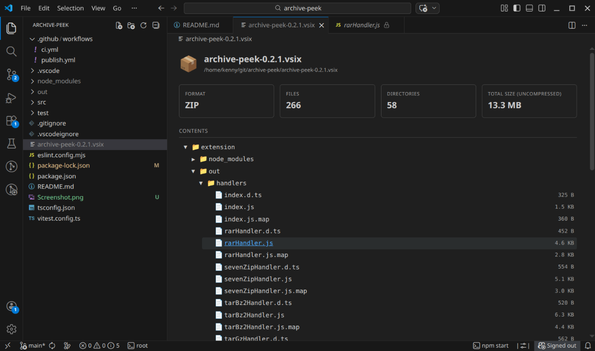

# Archive Peek for VS Code

Peek inside archive files directly in VS Code — without extracting them to disk. Simply click an archive in the Explorer and get an interactive file browser with stats, right inside the editor.



## Supported Formats

| Format | Extension(s) | Library Used
|---|---|---|
| ZIP          | `.zip`                    | yauzl
| JAR          | `.jar`, `.war`, `.ear`    | yauzl
| VS Code Ext  | `.vsix`                   | yauzl
| NuGet        | `.nupkg`                  | yauzl
| Android      | `.apk`, `.aar`            | yauzl
| Python Wheel | `.whl`                    | yauzl
| Firefox Ext  | `.xpi`                    | yauzl
| eBook        | `.epub`                   | yauzl
| Tar          | `.tar`                    | tar-stream
| Tar.gz       | `.tar.gz`, `.tgz`         | tar-stream + zlib
| Tar.bz2      | `.tar.bz2`, `.tbz2`       | tar-stream + unbzip2-stream
| Tar.xz       | `.tar.xz`, `.txz`         | tar-stream + xz-decompress
| Gzip         | `.gz`                     | zlib
| Bzip2        | `.bz2`                    | unbzip2-stream
| XZ           | `.xz`                     | xz-decompress
| RAR          | `.rar`                    | node-unrar-js
| 7-Zip        | `.7z`                     | node-7z + 7zip-bin

## Features

- **Click to browse** — click any archive in the Explorer and it opens an interactive file tree with stats in the editor
- **Open files inline** — click any file in the archive tree to view its contents in VS Code (read-only)
- **No extraction** — files are read directly from the archive stream, nothing written to disk
- **No sidebar clutter** — everything lives in the editor tab, no extra panels
- **23 file extensions** — covers ZIP-based, tar variants, standalone compressed, RAR, and 7z out of the box
- **Context menu integration** — right-click archive files in the Explorer for quick access
- **Auto-refresh** — when an opened archive is rebuilt or replaced on disk, the archive tab and any files opened from it reload automatically
- **Light on memory** — ZIP-based archives are streamed: only the file list is kept in memory, and the archive file is never held open, so build tools can overwrite it at any time

## Usage

1. Click any supported archive file in the VS Code Explorer
2. The archive opens in an editor tab showing format info, file/directory counts, total size, and a browsable file tree
3. Click any file in the tree to view its contents

You can also right-click an archive and select **Open Archive**, or use the command palette: `Archive Peek: Open Archive`.

## Commands

| Command                          | Description                                |
|----------------------------------|--------------------------------------------|
| `Archive Peek: Open Archive`    | Open an archive file for browsing          |
| `Archive Peek: Refresh`          | Re-read all opened archives and reload files opened from them |
| `Archive Peek: Close Archive`    | Close an opened archive                    |

## Settings

| Setting                  | Default | Description                                                                 |
|--------------------------|---------|-----------------------------------------------------------------------------|
| `archivePeek.autoRefresh` | `true`  | Reload opened archives (and files opened from them) when they change on disk |

## Development

```bash
# Install dependencies
npm install

# Validate - Compile + lint
npm run validate

# Watch mode
npm run watch

# Tests
npm test

# Benchmarks. Large fixture archives are generated in the OS temp dir on first run.
npm run bench            # speed benchmarks
npm run bench:memory     # memory retained while archives are open
npm run bench:baseline   # record speed + memory results into bench-results/ (e.g. on main)
npm run bench:compare    # compare the current code against that baseline (same machine only)
```

Timings depend on the machine, so only compare results recorded on the same machine. CI does this
on every push: it benchmarks `main`, then tests and benchmarks the pushed commit on the same runner,
and shows the comparison in the workflow log and on the run's summary page.

Press **F5** to launch the Extension Development Host.

## Requirements

- VS Code 1.101.0+
- For `.7z` support: the bundled `7zip-bin` package provides the 7z binary
- For `.tar.bz2` support: `unbzip2-stream`
- For `.tar.xz` support: `xz-decompress` (pure JS/WASM — no native binaries needed)
- For `.rar` support: `node-unrar-js` (pure JS/WASM — no native binaries needed)
